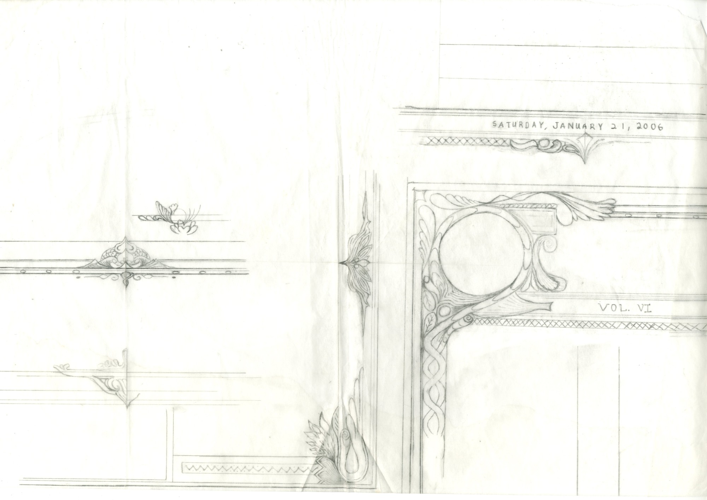
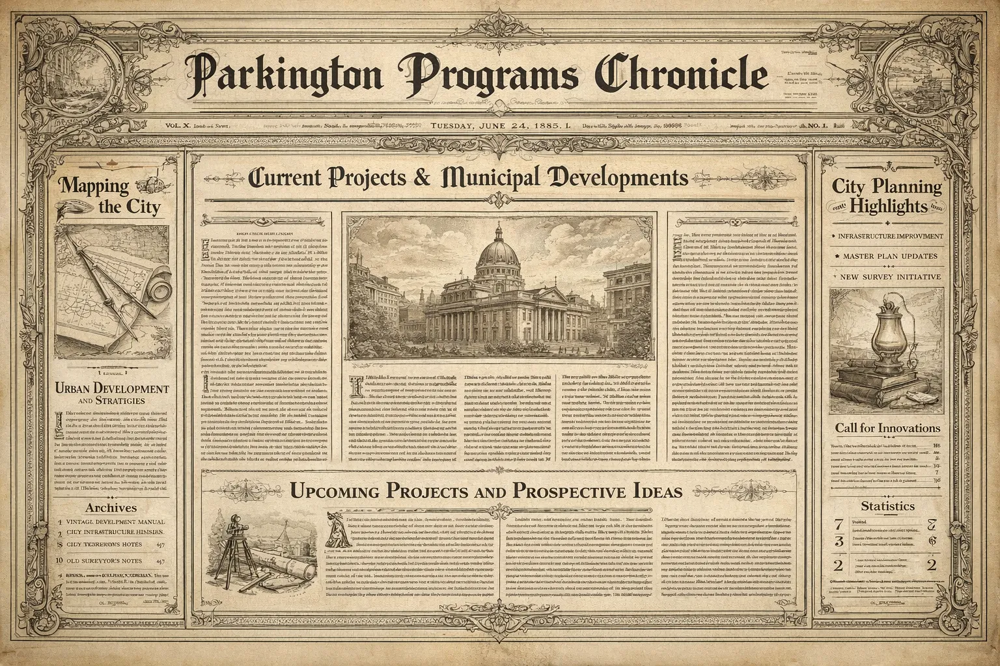
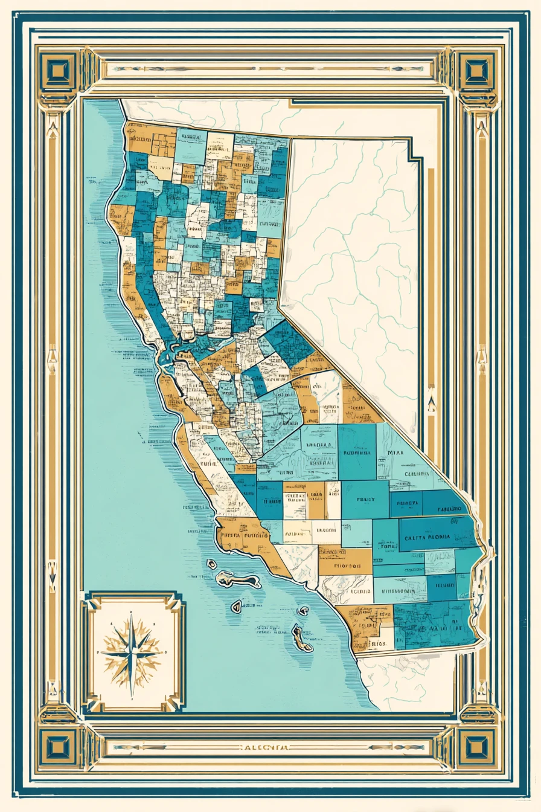
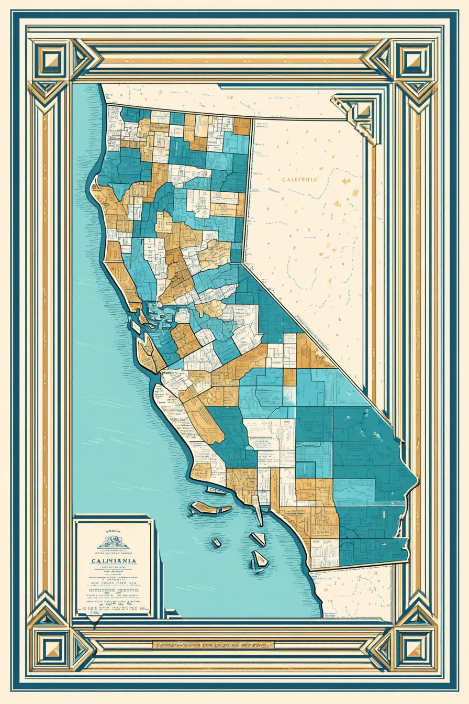
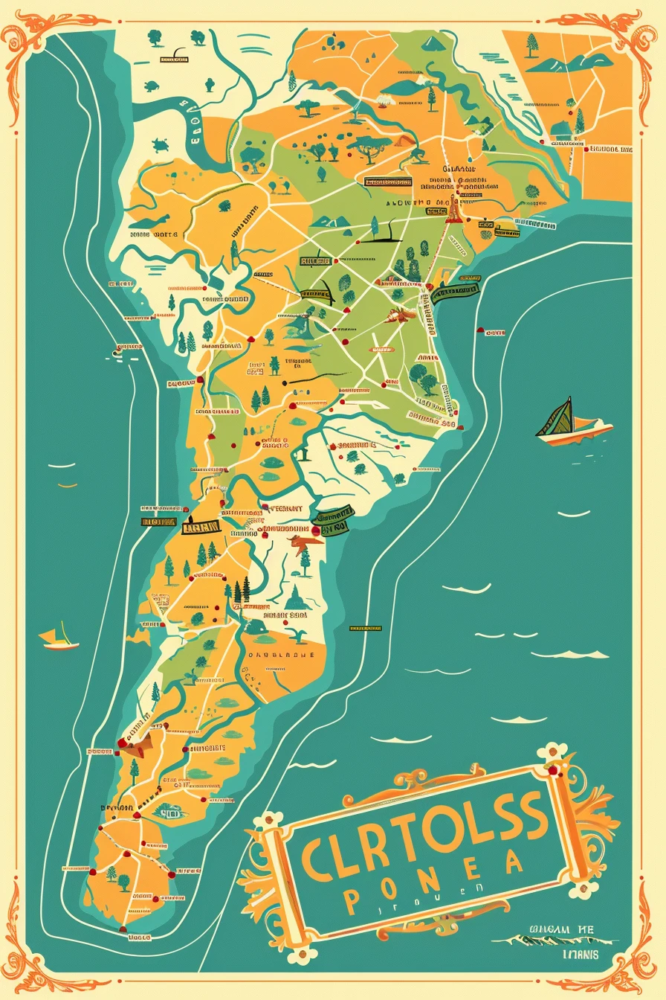
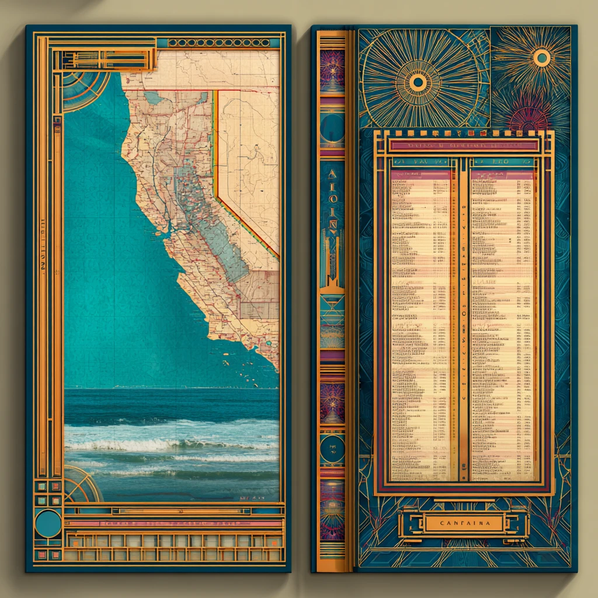
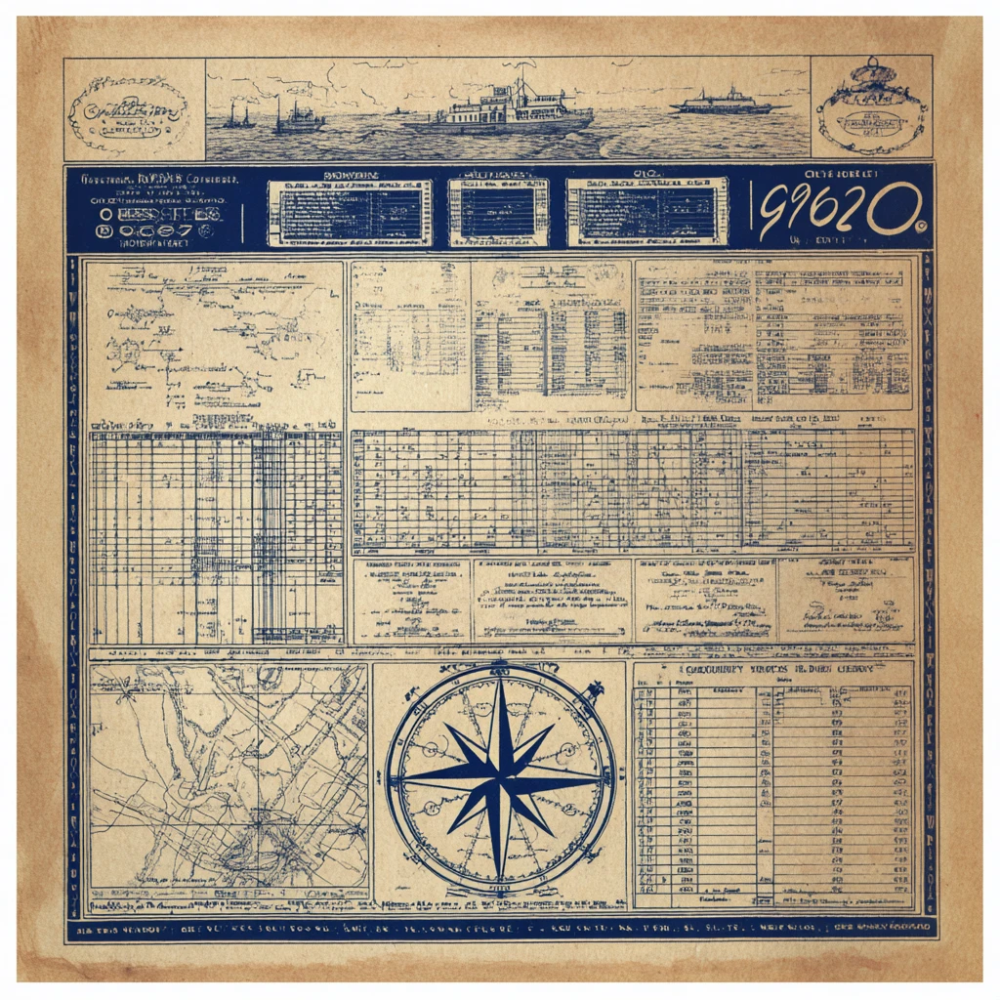
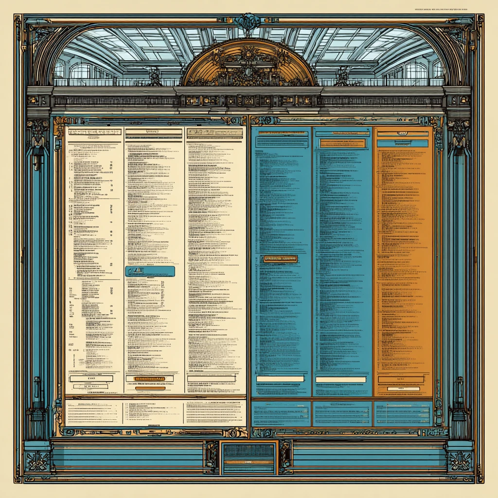
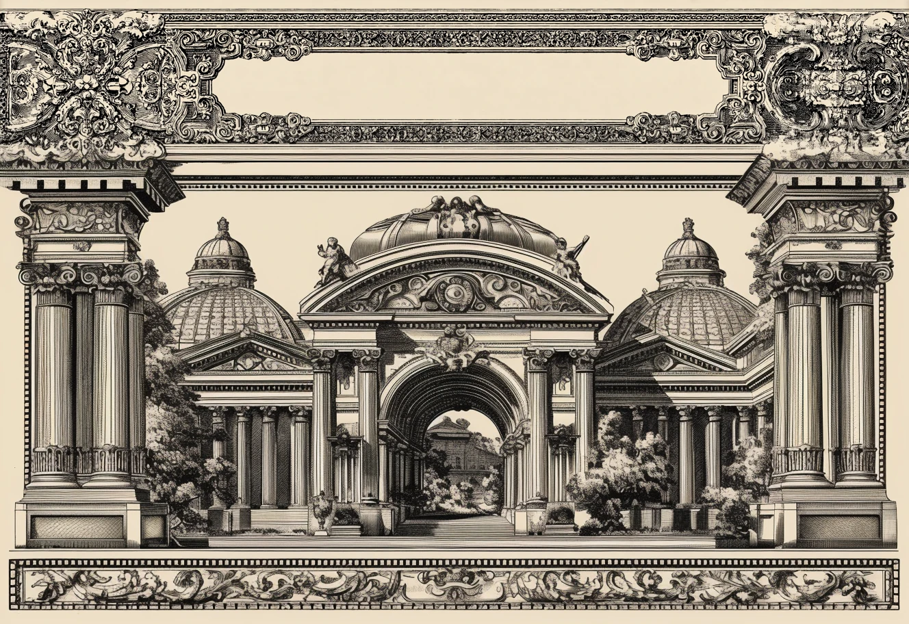
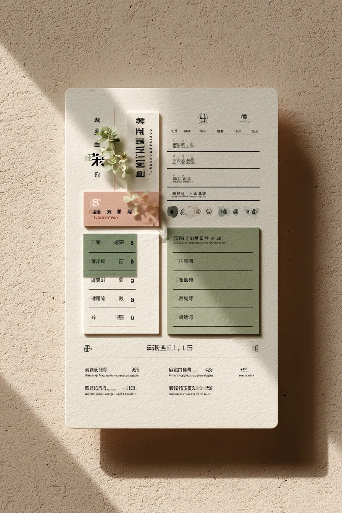

# References

Images that shaped Eloi's design. **They are inspiration, not specs.** They show a mood, a palette or a layout idea; nothing here is to be reproduced literally. Eloi is a framing engine, so maps in these images stand in for "whatever content sits inside the frame".

## Hand-drawn

| | |
|---|---|
|  | **Pencil frame sketch.** The owner's own drawing: a medallion corner, a twisted ribbon stem, side leaf, crest, jewel pendant, lattice cartouche, flame corner and tailpiece. Traced in Illustrator, it became `sites/portfolio/src/ornaments/source/websiteVectorOutline.svg` and the `hand-drawn.svg` sprite. Measured in [research/07](../research/07-drawing-analysis.md). |

## AI-generated

Each row names the style it informs.

| | |
|---|---|
|  | **Victorian chronicle front page.** *Victorian engraving, portfolio site.* A blackletter masthead, medallion corners, a dateline band, sidebars at roughly 1 : 3.5 : 1, a lead story and an "Upcoming Projects" panel. This is the layout idea for the portfolio. |
|  | **Mid-century county map (A).** *Mid-century mouldings, city game.* Nested flat-colour bands, square corner blocks, and an inset cartouche with a compass rose. The owner's traced `websiteOutline.svg` follows this frame. |
|  | **Mid-century county map (B).** *Mid-century mouldings.* A variant with stepped pyramid corner blocks and a title cartouche. |
|  | **Illustrated coast map.** *Mid-century, warmer.* Scroll-cornered thin border and a tilted title cartouche with flourishes. |
|  | **Art deco diptych.** *Art deco.* Stepped gold mouldings, sunburst fields, a spine track of medallions, and a ledger in an opening. |
|  | **Blueprint survey sheet.** *Blueprint.* A single-ink grid of panels, a ruled border track, tables and a compass rose. |
|  | **Beaux-Arts arcade.** *Beaux-Arts orders and arches.* Columns and an arch frame columns of content in flat colour. |
|  | **Engraved colonnade.** *Beaux-Arts engraving.* A cartouche header between capitals, column stacks as side members, and a scroll frieze as the base track. |
|  | **Minimal modern cards.** *Minimal.* The low end of the range: flat cards, rules and overlap, with almost no ornament. |
